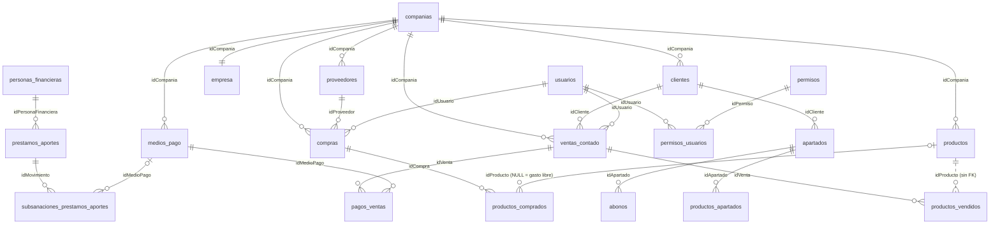

# Modelo de datos

Fuente de verdad del esquema **vigente** en producción (SQLite, `/data/sublime-pos.sqlite` en Railway). El esquema efectivo es `backend/sql/schema.sql` **más** las migraciones de `backend/src/db.js`. Este documento refleja el resultado combinado.

> **Mantenimiento**: toda feature que cambie el esquema actualiza este archivo en su fase de implementación: tablas, columnas, diagrama y la sección **Historial de cambios**.

Última revisión: 2026-11-22, contra la base de producción (23 tablas).

## Convenciones

| Tema | Regla |
|---|---|
| Nombres | Tablas en `snake_case` plural y en español. Columnas en `camelCase`. PK `id<Entidad>` `INTEGER PRIMARY KEY AUTOINCREMENT`. |
| Empresa | `idCompania INTEGER DEFAULT 1` en las tablas de negocio. Las consultas filtran por la empresa activa (header `x-compania-id`). |
| Fechas | `TEXT` `YYYY-MM-DD HH:MM:SS`, hora local de `America/Bogota`. |
| Dinero y cantidades | `REAL`, en COP. |
| Booleanos | `INTEGER` 0/1 (`activa`, `activo`). |
| Estados | `TEXT` con valores en MAYÚSCULAS (ver **Enumeraciones**). |
| Snapshots | Las tablas de detalle (`productos_vendidos`, `productos_comprados`, `productos_apartados`) copian descripción y precios del producto al momento de la operación. |
| FK | `PRAGMA foreign_keys = ON`. Casi todas son `ON DELETE CASCADE`, salvo `productos_comprados.idProducto` (`RESTRICT`). |

## Diagrama entidad-relación

## Tablas por dominio

### Organización y acceso

**`companias`**: empresas (multi-tenant).

| Columna | Tipo | Notas |
|---|---|---|
| idCompania | INTEGER PK | 1 = "Dela Crepes" (semilla) |
| nombre | TEXT NN UNIQUE | |
| activa | INTEGER NN =1 | |

**`empresa`**: datos impresos en tickets, uno por compañía.

| Columna | Tipo | Notas |
|---|---|---|
| idEmpresa | INTEGER PK | |
| idCompania | INTEGER | |
| nombre, direccion, telefono, mensajePersonal | TEXT | |

**`usuarios`**

| Columna | Tipo | Notas |
|---|---|---|
| idUsuario | INTEGER PK | 1 = `admin` (semilla) |
| nombre | TEXT NN UNIQUE | Login |
| contrasena | TEXT NN | Hash `scrypt:<salt>:<hash>`. Las contraseñas en texto plano se cifran al arrancar |
| idCompania | INTEGER =1 | No se usa para restringir acceso |

**`permisos`** (`idPermiso` PK, `clave` UNIQUE, `descripcion`) y **`permisos_usuarios`** (`idUsuario`, `idPermiso`, UNIQUE en el par). Se devuelven en el login, pero **hoy no se aplican** ni en el backend ni en las rutas.

**`comun`**: configuración clave/valor.

| Columna | Tipo | Notas |
|---|---|---|
| clave | TEXT PK | Las claves por empresa llevan el sufijo `_<idCompania>`, p. ej. `IMPRESION_WIDTH_1` |
| valor | TEXT | |
| idCompania | INTEGER =1 | |

Claves conocidas: `IMPRESION_WIDTH_n`, `IMPRESION_TICKET_CLIENTE_n`, `IMPRESION_COMANDA_COCINA_n`, `PRESTAMOS_APORTES_DELETE_PASSWORD_HASH_n`, `AUTH_SECRET` (respaldo si no hay variable de entorno), marcadores de scripts como `IMPORT_MAY_2026_SALES_V1`, y claves heredadas sin uso (`NOMBRE_IMPRESORA`, `MODO_*`, `NUMERO_COPIAS_*`, `CREATED_BY`).

### Catálogo

**`productos`**

| Columna | Tipo | Notas |
|---|---|---|
| idProducto | INTEGER PK | |
| codigoBarras | TEXT UNIQUE | ⚠ UNIQUE **global**, aunque la app valida la disponibilidad por compañía |
| descripcion | TEXT NN | Nombre visible |
| precioCompra | REAL NN | Costo; se actualiza con las compras |
| precioVenta | REAL NN | |
| existencia | REAL NN | Inventario actual: la venta descuenta, la anulación y la compra suman |
| stock | REAL NN | Nivel de referencia de inventario mínimo |
| idCompania | INTEGER =1 | |

No hay categorías, variantes, ingredientes ni modificadores. Ver **Brechas conocidas**.

**`clientes`**: `idCliente` PK (1 = "Mostrador", semilla), `nombreCompleto` NN, `numeroTelefono` NN, `nit` ='', `direccion` ='', `idCompania`.

**`proveedores`**: `idProveedor` PK, `nombre` NN, `numeroTelefono`, `correo`, `direccion`, `idCompania`.

**`medios_pago`**: `idMedioPago` PK, `idCompania`, `nombre` NN, `activo` NN =1. Semilla: Efectivo, Tarjeta, Transferencia (+ Nequi en compañías nuevas).

### Ventas

**`ventas_contado`**: cabecera de la venta o pedido.

| Columna | Tipo | Notas |
|---|---|---|
| idVenta | INTEGER PK | |
| monto | REAL NN | Total de la venta |
| pago | REAL NN =0 | Total pagado, suma de `pagos_ventas` |
| estadoPago | TEXT NN ='PAGADA' | Se deriva de `monto` contra `pago` |
| estadoPreparacion | TEXT NN ='PENDIENTE' | Pantalla de pedidos (cocina) |
| fecha | TEXT NN | Cuándo ocurrió la venta |
| fechaRegistro | TEXT | Cuándo se registró |
| fechaCumplido | TEXT | Cuándo cocina la marcó cumplida |
| idCliente | INTEGER NN FK | |
| idUsuario | INTEGER NN FK | |
| idCompania | INTEGER =1 | |

**`productos_vendidos`**: líneas de la venta (snapshot). Sin PK propia.

| Columna | Tipo | Notas |
|---|---|---|
| idVenta | INTEGER NN FK | |
| idProducto | INTEGER NN | Sin FK a `productos` |
| codigoBarras, descripcion | TEXT | Copia del producto |
| precioCompra, precioVenta, precioVentaOriginal | REAL NN | `precioVenta` puede diferir del original (precio editado en la venta) |
| cantidadVendida | REAL NN | |
| nota | TEXT ='' | Texto libre por línea; hoy es el único lugar para personalizar el pedido |

**`pagos_ventas`**: `idPagoVenta` PK, `idVenta` NN FK, `idMedioPago` NN FK, `monto` NN, `referencia`. Una venta tiene 0..n pagos.

### Compras

**`compras`**: `idCompra` PK, `monto` NN, `pago` NN =0, `fecha` NN, `fechaRegistro`, `idProveedor` NN FK, `idUsuario` NN FK, `idCompania`.

**`productos_comprados`**: líneas (snapshot), sin PK. `idProducto` **nullable** (`NULL` = gasto o insumo libre que no afecta inventario), `idCompra` NN FK, `codigoBarras`, `descripcion` NN, `precioCompra` NN, `precioVenta` NN, `cantidadComprada` NN.

### Dinero fuera de ventas y compras

**`personas_financieras`**: `idPersonaFinanciera` PK, `nombre` NN, `relacion` NN, `numeroTelefono`, `notas`, `idCompania`.

**`prestamos_aportes`**: `idMovimiento` PK, `idPersonaFinanciera` NN FK, `tipo` NN, `monto` NN, `fecha` NN, `descripcion`, `idUsuario` NN FK, `idCompania`.

**`subsanaciones_prestamos_aportes`**: abonos sobre un movimiento. `idSubsanacion` PK, `idMovimiento` NN FK, `monto` NN, `fecha` NN, `idMedioPago` FK nullable, `referencia`, `descripcion`, `idUsuario` NN FK. El estado del movimiento (`PENDIENTE`/`PARCIAL`/`SUBSANADO`) se calcula, no se guarda.

**`ingresos`** / **`egresos`**: `id*` PK, `monto` NN, `descripcion` NN, `fecha` NN, `idUsuario` NN FK, `idCompania`. Tienen endpoints de creación y entran en caja, pero hoy no hay registros.

### Heredadas sin uso

**`apartados`**, **`productos_apartados`** y **`abonos`**: modelo de apartados del sistema original. No hay rutas ni datos. No se borran (principio 1).

## Enumeraciones

| Campo | Valores |
|---|---|
| `ventas_contado.estadoPago` | `PENDIENTE`, `PARCIAL`, `PAGADA` |
| `ventas_contado.estadoPreparacion` | `PENDIENTE`, `CUMPLIDO` |
| `prestamos_aportes.tipo` | `APORTE_AL_NEGOCIO`, `RETIRO_DEL_NEGOCIO`, `PRESTAMO_AL_NEGOCIO`, `PRESTAMO_DEL_NEGOCIO`, `DEVOLUCION_RECIBIDA`, `DEVOLUCION_PAGADA` |
| Estado de un préstamo/aporte (calculado) | `PENDIENTE`, `PARCIAL`, `SUBSANADO` |
| `personas_financieras.relacion` | `Dueno`, `Socio`, `Familiar`, `Empleado`, `Tercero`, `Inversionista` (lista del frontend) |

## Efectos en caja

`/api/caja/resumen` y `/api/caja/movimientos` combinan:

- Entradas: `pagos_ventas`, `ingresos`, `prestamos_aportes` de tipo `APORTE_AL_NEGOCIO`, `PRESTAMO_AL_NEGOCIO` y `DEVOLUCION_RECIBIDA`, y sus subsanaciones.
- Salidas: los pagos de `compras`, `egresos`, y los demás tipos de `prestamos_aportes`.

Cualquier tabla nueva que mueva dinero debe integrarse en ambos endpoints.

## Brechas conocidas

- **Toma de pedidos personalizada**: no existen categorías, ingredientes, toppings, salsas, adiciones ni modificadores con precio. Hoy la personalización es texto libre en `productos_vendidos.nota`, y las adiciones con precio se venden como productos aparte.
- `productos.codigoBarras` tiene UNIQUE global, no por compañía.
- `productos_vendidos` no tiene PK ni FK a `productos`, así que no se puede referenciar una línea de venta individual (por ejemplo, para colgarle modificadores) sin agregar una PK.
- Los permisos existen en datos pero no se aplican.

## Historial de cambios

| Fecha | Feature | Cambio |
|---|---|---|
| 2026-11-22 | — | Documento inicial a partir de la base de producción. |
