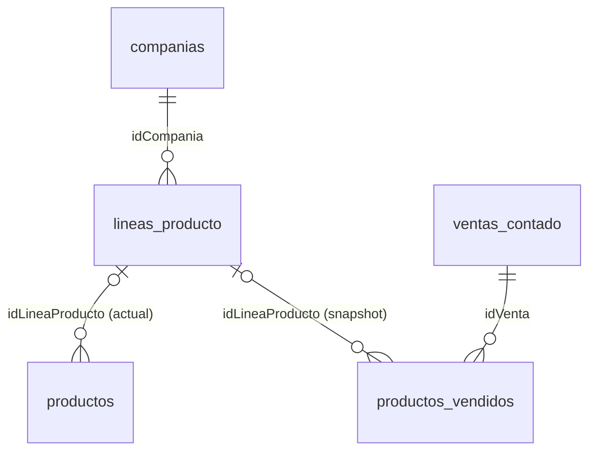

# Design: Líneas de producto y ventas por línea

> Describe **CÓMO** se construye lo que pide `spec.md`, respetando `sdd/constitucion.md`. Antes de escribir, lee el código involucrado y `sdd/data-model.md`.

## 1. Resumen de la solución

- Se agrega la tabla `lineas_producto` (por compañía).
- `productos` gana la columna `idLineaProducto` (la línea actual del producto).
- `productos_vendidos` gana `idLineaProducto` como **snapshot**: la línea con que se vendió cada renglón.
- Backend: CRUD de líneas, asignación masiva, la línea en crear y editar producto, y un endpoint de reporte de ventas por línea.
- Frontend: una vista nueva **Clasificación** (pestaña *Líneas de producto*, a la que la feature 003 añade pestañas), el selector de línea en Productos y el reporte "Ventas por línea" en Reportes.

## 2. Decisiones

### D-01: Snapshot de la línea en cada renglón vendido

- **Opciones consideradas**: A) calcular la línea siempre desde el producto actual (JOIN); B) guardar la línea en `productos_vendidos` al vender.
- **Elegida**: B.
- **Por qué**: RF-08 exige que mover un producto no cambie los reportes pasados. Además, ya es el patrón del sistema (descripción y precios también son snapshot).
- **Consecuencias**: hay que completar el histórico (D-02) y preservar el snapshot al editar una venta (D-03).

### D-02: Clasificación del histórico en la primera asignación

- **Opciones consideradas**: A) script de migración único; B) cuando un producto recibe línea, completar `productos_vendidos.idLineaProducto` de sus renglones que aún están en `NULL`.
- **Elegida**: B.
- **Por qué**: el usuario crea las líneas y asigna productos después del despliegue, así que un script en el despliegue no tendría líneas que asignar. Con B, la primera vez que un producto recibe línea (desde Productos o desde la asignación masiva), todas sus ventas sin clasificar toman esa línea (RF-09). Los cambios posteriores solo afectan ventas futuras, porque ya no hay `NULL` (RF-08).
- **Consecuencias**: las ventas hechas mientras el producto estuvo "Sin línea" también se clasifican al asignarlo (CA-04 se cumple mientras tanto). Quitar la línea de un producto (dejarlo sin línea) no borra snapshots.

### D-03: Editar una venta conserva el snapshot

`PUT /api/ventas/contado/:id` borra y reinserta los renglones. Antes de borrar se guarda el mapa `idProducto → idLineaProducto` de los renglones anteriores. Al reinsertar, cada producto que ya estaba conserva su línea; un producto nuevo en la venta toma la línea actual del producto.

### D-04: "Clasificación" como vista contenedora

Una sola entrada de menú (**Clasificación**, ruta `/clasificacion`) con pestañas. En esta feature: *Líneas de producto*. La feature 003 agrega *Centros de costo*, *Tipos de gasto* y *Clasificar compras*. El CRUD se implementa con un componente reutilizable `CatalogoCrud.vue` (nombre, activo y columnas extra), que también servirá para los centros y tipos de 003.

### D-05: Eliminación lógica restringida

`DELETE` solo procede si la línea no tiene productos (`productos.idLineaProducto`) ni ventas (`productos_vendidos.idLineaProducto`). Si los tiene, responde **409** con el conteo y la UI ofrece desactivar. Una línea inactiva no aparece en los selectores de Productos, pero sí en los reportes.

### D-06: El filtro por línea en el reporte por ítem es un atajo del frontend (RF-07)

En el reporte existente, elegir una línea **preselecciona los productos que hoy pertenecen a esa línea** en el filtro de productos ya existente. No cambia el endpoint `/api/ventas/contado`. La diferencia con el snapshot solo aparece si un producto se movió de línea, y la UI lo aclara ("productos actuales de la línea"). Para cifras exactas por línea está el reporte nuevo.

### D-07: Nombres únicos por compañía, sin distinguir mayúsculas

Índice único `(idCompania, nombre COLLATE NOCASE)`. Un duplicado responde 409 con un mensaje claro.

## 3. Modelo de datos

### 3.1 Cambios

| Tabla | Cambio | Detalle |
|---|---|---|
| `lineas_producto` | Nueva | `idLineaProducto INTEGER PK AUTOINCREMENT`, `idCompania INTEGER NOT NULL`, `nombre TEXT NOT NULL`, `activa INTEGER NOT NULL DEFAULT 1`, `fechaRegistro TEXT` |
| `productos` | Columna nueva | `idLineaProducto INTEGER REFERENCES lineas_producto (idLineaProducto)`, nullable (NULL = "Sin línea") |
| `productos_vendidos` | Columna nueva | `idLineaProducto INTEGER REFERENCES lineas_producto (idLineaProducto)`, nullable (snapshot; NULL = sin clasificar) |
| índices | Nuevos | `UNIQUE lineas_producto (idCompania, nombre COLLATE NOCASE)`; `productos_vendidos (idLineaProducto)`; `productos (idLineaProducto)` |

### 3.2 Migración

- [ ] `backend/sql/schema.sql`: `CREATE TABLE IF NOT EXISTS lineas_producto …` y los índices `IF NOT EXISTS`. Va antes de cualquier referencia.
- [ ] `backend/sql/schema.sql`: agregar `idLineaProducto` a las definiciones de `productos` y `productos_vendidos`, para bases nuevas.
- [ ] `backend/src/db.js`: bloque idempotente que hace `ALTER TABLE … ADD COLUMN idLineaProducto …` en `productos` y `productos_vendidos` si `PRAGMA table_info` no la muestra. SQLite permite `ADD COLUMN … REFERENCES` con default NULL.
- [ ] Los índices sobre las columnas nuevas se crean en `db.js`, **después** del `ALTER`. No van en `schema.sql`, porque fallarían en una base existente antes de que la columna exista.
- [ ] Backfill: ninguno en el despliegue (D-02). Todas las filas quedan en NULL = "Sin línea".
- [ ] Riesgo para los datos existentes: **bajo**. Solo se agregan columnas nullable y una tabla; no se reescribe ninguna tabla existente.

```sql
CREATE TABLE IF NOT EXISTS lineas_producto (
  idLineaProducto INTEGER NOT NULL PRIMARY KEY AUTOINCREMENT,
  idCompania INTEGER NOT NULL,
  nombre TEXT NOT NULL,
  activa INTEGER NOT NULL DEFAULT 1,
  fechaRegistro TEXT
);
CREATE UNIQUE INDEX IF NOT EXISTS ux_lineas_producto_nombre ON lineas_producto (idCompania, nombre COLLATE NOCASE);

-- db.js (solo si la columna no existe)
ALTER TABLE productos ADD COLUMN idLineaProducto INTEGER REFERENCES lineas_producto (idLineaProducto);
ALTER TABLE productos_vendidos ADD COLUMN idLineaProducto INTEGER REFERENCES lineas_producto (idLineaProducto);
CREATE INDEX IF NOT EXISTS ix_productos_linea ON productos (idLineaProducto);
CREATE INDEX IF NOT EXISTS ix_productos_vendidos_linea ON productos_vendidos (idLineaProducto);
```

### 3.3 Diagrama



## 4. API

Todas detrás de autenticación y filtradas por `companiaId(req)`.

| Método | Ruta | Request | Response | Errores |
|---|---|---|---|---|
| GET | `/api/lineas-producto` | `?incluirInactivas=1` | `[{ idLineaProducto, nombre, activa, cantidadProductos, cantidadVentas }]` ordenado por nombre | — |
| POST | `/api/lineas-producto` | `{ nombre }` | 201 línea creada | 400 nombre vacío; 409 nombre duplicado |
| PUT | `/api/lineas-producto/:id` | `{ nombre, activa }` | línea actualizada | 404; 409 duplicado |
| DELETE | `/api/lineas-producto/:id` | — | 204 | 404; 409 `{ error, cantidadProductos, cantidadVentas }` si está en uso |
| POST | `/api/lineas-producto/asignar` | `{ idLineaProducto \| null, idProductos: [] }` | `{ actualizados, ventasClasificadas }` | 400 lista vacía; 404 línea inexistente o inactiva |
| GET | `/api/productos` | (sin cambios) | agrega `idLineaProducto` y `lineaProducto` (nombre) a cada producto | — |
| POST/PUT | `/api/productos[/:id]` | acepta `idLineaProducto` opcional (null = sin línea) | producto | 400 si la línea no es de la compañía o está inactiva (salvo que sea la que ya tenía) |
| GET | `/api/reportes/ventas-por-linea` | `?desde&hasta&idUsuario` | ver abajo | — |

Para la asignación (la masiva y la de crear o editar producto) se usa una sola función interna, `asignarLineaAProductos(idCompania, idLinea, idProductos)`, que dentro de una transacción:
1. actualiza `productos.idLineaProducto`;
2. si `idLinea` no es NULL, ejecuta `UPDATE productos_vendidos SET idLineaProducto = ? WHERE idProducto IN (…) AND idLineaProducto IS NULL AND idVenta IN (SELECT idVenta FROM ventas_contado WHERE idCompania = ?)` (D-02).

Respuesta del reporte:

```json
{
  "totalVendido": 18147100, "unidades": 1450, "numeroVentas": 606,
  "lineas": [
    { "idLineaProducto": 1, "nombre": "Sodas y burritos", "unidades": 900, "valor": 11500000,
      "numeroVentas": 420, "porcentaje": 63.37,
      "productos": [{ "idProducto": 3, "descripcion": "Burrito Mixto", "unidades": 340, "valor": 5440000, "numeroVentas": 300 }] },
    { "idLineaProducto": null, "nombre": "Sin línea", "...": "..." }
  ]
}
```

Consulta base: `productos_vendidos pv JOIN ventas_contado v` filtrada por compañía, `date(v.fecha)` en el rango y el usuario opcional, agrupada por `pv.idLineaProducto` y luego por `pv.idProducto, pv.descripcion`. `valor = SUM(pv.precioVenta * pv.cantidadVendida)`, `numeroVentas = COUNT(DISTINCT v.idVenta)`. `totalVendido` es la suma de `valor` de todas las líneas. Se verificó contra la base de producción que `SUM(monto)` de las ventas es igual a la suma de sus renglones (18.147.100 en ambos), así que RNF-02 se cumple por construcción. Las ventas anuladas se borran físicamente, por lo que no aparecen (RF-10).

## 5. Interfaz

### 5.1 Pantallas y navegación

| Elemento | Cambio |
|---|---|
| `frontend/src/views/ClasificacionView.vue` | Nueva. Pestañas; en esta feature solo *Líneas de producto*. |
| `frontend/src/components/CatalogoCrud.vue` | Nuevo. Lista, crea, renombra, activa/desactiva y elimina un catálogo simple (D-04). |
| `frontend/src/components/AsignarLineaDialog.vue` | Nuevo. Asignación masiva de productos a una línea. |
| `router.js` / `App.vue` | Ruta `/clasificacion` e ítem de menú **Clasificación** (`mdi-shape-outline`), después de *Productos*. |
| `ProductosView.vue` | Selector **Línea** en el formulario; columna **Línea** en la tabla; filtro por línea (chips) sobre la lista. |
| `ReportesView.vue` | Selector de tipo de reporte (`Ventas` actual / `Ventas por línea`) y, en `Ventas`, el atajo "Productos de la línea…" (D-06). |

### 5.2 Flujo y bocetos

**Clasificación → Líneas de producto** (celular 360 px; en tablet y escritorio la lista pasa a tabla y "Productos de la línea" se muestra a la derecha):

```
┌──────────────────────────────┐
│ Clasificación                │
│ [Líneas] [Centros*] [Tipos*] │  * feature 003
├──────────────────────────────┤
│ [+ Nueva línea]  [Asignar ▸] │
│ ┌──────────────────────────┐ │
│ │ Sodas y burritos      ⋮  │ │  ⋮ = Renombrar / Desactivar / Eliminar
│ │ 9 productos · activa     │ │
│ └──────────────────────────┘ │
│ ┌──────────────────────────┐ │
│ │ Sin línea                │ │  pseudo-línea, no editable
│ │ 22 productos             │ │
│ └──────────────────────────┘ │
└──────────────────────────────┘
```

**Asignar productos** (diálogo a pantalla completa en `xs`):

```
┌──────────────────────────────┐
│ ✕  Asignar productos         │
│ Línea destino: [Sodas y b ▾] │
│ 🔍 Buscar   [Solo sin línea] │
│ ☑ Burrito Mixto   Sin línea  │  filas de 56 px
│ ☑ Burrito Pollo   Sin línea  │
│ ☐ Crepocho        Fresas y…  │
│ ...                          │
├──────────────────────────────┤
│ [ Asignar 2 productos ]      │  botón fijo abajo
└──────────────────────────────┘
```

**Reportes → Ventas por línea**:

```
┌──────────────────────────────┐
│ Desde [..] Hasta [..] Usuario│
│ Total vendido $18.147.100    │
│ ┌──────────────────────────┐ │
│ │ Sodas y burritos   63,4% │ │  barra de proporción
│ │ ███████████████░░░░░░░░  │ │
│ │ $11.500.000 · 900 u ·420v│ │  toca → despliega productos
│ └──────────────────────────┘ │
│ ┌──────────────────────────┐ │
│ │ Sin línea           0,0% │ │
│ └──────────────────────────┘ │
└──────────────────────────────┘
```

### 5.3 Touch y responsive

- Botones y filas de lista ≥ 48 px de alto. Los menús de acción (⋮) abren un `v-menu` con ítems de 48 px.
- `xs`: tarjetas y diálogos a pantalla completa (`:fullscreen="$vuetify.display.xs"`). `md+`: `v-data-table` y diálogos de 560 px.
- Estados: *cargando* (skeleton o loading en la tabla), *vacío* ("Aún no hay líneas. Crea la primera."), *error* (`v-alert` con el mensaje de la API). El 409 al eliminar muestra un diálogo con la opción "Desactivar".

## 6. Reglas de negocio y cálculos

- Al vender (`POST /api/ventas/contado`), cada renglón guarda `idLineaProducto = productos.idLineaProducto` en ese momento.
- Al editar una venta, aplica D-03.
- Asignar una línea a productos aplica D-02.
- Se puede asignar una línea inactiva solo si el producto ya la tenía (por ejemplo, al editar otro campo del producto). No se pueden asignar productos nuevos a una línea inactiva.
- Porcentaje = `valor / totalVendido × 100`, redondeado a 2 decimales en la respuesta. Con total 0, el porcentaje es 0.

## 7. Impacto en caja, inventario y reportes

| Área | Impacto | Cambio necesario |
|---|---|---|
| `/api/caja/resumen` | ninguno | — |
| `/api/caja/movimientos` | ninguno | — |
| Inventario (`existencia`) | ninguno | — |
| Reportes | nuevo reporte; el reporte por ítem gana un atajo de filtro | §4, §5 |
| Pantalla de pedidos | ninguno | — |
| Venta (POST/PUT) | guarda el snapshot de la línea | §6 |

## 8. Seguridad y permisos

Las rutas nuevas quedan detrás del middleware de autenticación existente. No se aplican permisos por rol (limitación conocida del sistema; fuera de alcance según la spec).

## 9. Compatibilidad

- Las ventas, productos y reportes existentes funcionan igual, con todo "Sin línea" hasta que el usuario asigne.
- El frontend tolera productos sin `idLineaProducto`.
- No cambia la forma de las respuestas existentes; solo se agregan campos.

## 10. Riesgos y mitigaciones

| Riesgo | Probabilidad / impacto | Mitigación |
|---|---|---|
| `ALTER TABLE` sobre `productos_vendidos` (1.028 filas) falla a mitad | Baja / medio | Probar con una copia de producción; el `ALTER ADD COLUMN` de SQLite es atómico; arrancar el backend dos veces. |
| La asignación masiva clasifica ventas que el usuario no esperaba | Media / bajo | El diálogo informa "Se clasificarán N ventas históricas sin línea"; el endpoint devuelve `ventasClasificadas`. |
| Al editar una venta se pierde el snapshot | Media / medio | D-03; verificación específica en el plan. |

## 11. Trazabilidad

| Requisito / criterio | Dónde se resuelve |
|---|---|
| RF-01, CA-01, CA-02 | §3 `lineas_producto`, §4 CRUD, D-05, D-07, §5 `CatalogoCrud` |
| RF-02 | §4 POST/PUT productos, §5 ProductosView |
| RF-03, RF-04, CA-03, CA-04 | §4 `/asignar`, §5 `AsignarLineaDialog`, pseudo-línea "Sin línea" |
| RF-05, RF-06, CA-05, CA-06, CA-07 | §4 `/reportes/ventas-por-linea`, §5 Reportes |
| RF-07 | D-06 |
| RF-08, CA-08 | D-01, D-03, §6 |
| RF-09, CA-09 | D-02 |
| RF-10 | §4 (anulación = borrado físico) |
| RNF-01, CA-10 | §5.3 |
| RNF-02 | §4 (suma de renglones = `monto`, verificado) |
| RNF-03 | §6 (el snapshot se toma del producto ya leído en la venta; sin pasos nuevos) |
| RNF-04 | `idCompania` en `lineas_producto` y filtros |
| RNF-05 | §7 |

## Historial

| Fecha | Cambio |
|---|---|
| 2026-11-24 | Borrador inicial |
| 2026-11-24 | Design aprobado por el usuario |
