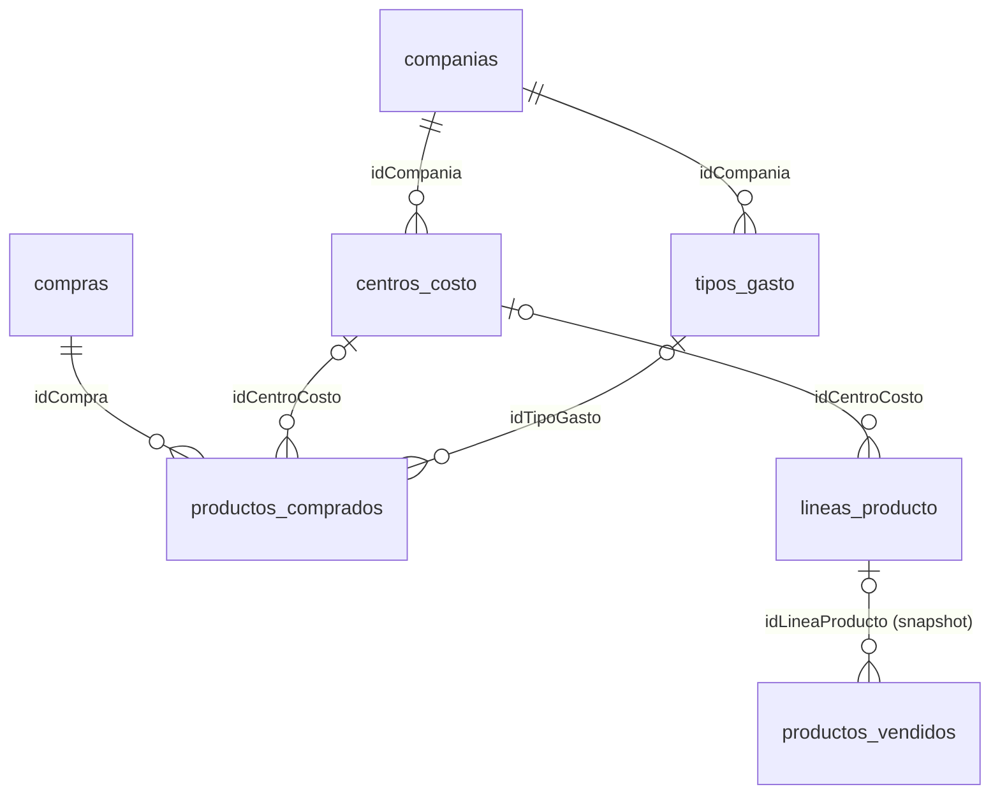

# Design: Centros de costo en compras

> Describe **CÓMO** se construye lo que pide `spec.md`, respetando `sdd/constitucion.md`. Antes de escribir, lee el código involucrado y `sdd/data-model.md`.

## 1. Resumen de la solución

- Tablas nuevas `centros_costo` y `tipos_gasto` (por compañía).
- `productos_comprados` se reconstruye para darle **llave primaria** propia y las columnas `idCentroCosto` e `idTipoGasto`.
- `lineas_producto` (de 002) gana `idCentroCosto`.
- Backend:
  - CRUD de centros y tipos (un solo generador de rutas compartido con las líneas);
  - centro obligatorio en cada ítem al crear o editar compras, también las que nacen de Préstamos y aportes;
  - sugerencias por descripción;
  - clasificación masiva del histórico;
  - corrección puntual de un ítem;
  - dos reportes: compras por centro y resultado por centro.
- Frontend:
  - en Compras, selectores de centro y tipo con atajo para toda la compra y sugerencia;
  - en Préstamos y aportes, los mismos selectores en la conversión a compra;
  - tres pestañas nuevas en **Clasificación**: Centros de costo, Tipos de gasto y Clasificar compras;
  - el centro de cada línea en la pestaña Líneas;
  - dos reportes nuevos en Reportes.

## 2. Decisiones

### D-01: Reconstruir `productos_comprados` con PK propia

- **Opciones consideradas**: A) usar el `rowid` implícito de SQLite; B) reconstruir la tabla con `idProductoComprado INTEGER PRIMARY KEY AUTOINCREMENT`.
- **Elegida**: B.
- **Por qué**: RF-06 y RF-11 necesitan apuntar a un ítem concreto. Sin una `INTEGER PRIMARY KEY` explícita, SQLite puede renumerar el `rowid` en un `VACUUM`, así que no sirve como referencia estable. `db.js` ya reconstruyó esta misma tabla antes con el patrón rename → create → `INSERT … SELECT` → drop, y se reutiliza ese patrón.
- **Consecuencias**: es la única migración que reescribe una tabla existente (806 filas). Se hace en una transacción, se copia en orden de `rowid` (el `idProductoComprado` queda igual al `rowid` anterior) y se valida que el conteo y la suma de `precioCompra × cantidadComprada` sean iguales antes y después (ver §3.2).

### D-02: Centro por ítem, obligatorio en compras nuevas **y** editadas

- Crear (`POST /api/compras`) y editar (`PUT /api/compras/:id`) exigen `idCentroCosto` válido en cada ítem (RF-02). Editar una compra histórica obliga a clasificarla, lo cual es deseable.
- El tipo de gasto es opcional (RF-13).
- Corregir solo la clasificación de un ítem **no** pasa por `PUT /api/compras/:id`, porque ese camino borra y reinserta ítems y recalcula inventario. Se usa un endpoint propio que solo actualiza las dos columnas (D-05, RF-11, RNF-04).

### D-03: Sugerencias desde el historial, calculadas en el backend y aplicadas en el frontend

- `GET /api/compras/sugerencias-clasificacion` devuelve un mapa `{ descripcionNormalizada → { idCentroCosto, idTipoGasto } }` con la clasificación del ítem **más reciente** de cada descripción ya clasificada. Hay unas 521 descripciones, unos KB.
- El frontend lo carga una vez al abrir Compras y sugiere al instante mientras se escribe, sin una petición por tecla (RNF-01).
- Normalización de la descripción: minúsculas, sin tildes y con los espacios colapsados (`normalizarDescripcion` en `utils.js`, que se usa también para agrupar en D-04).

### D-04: Clasificación del histórico agrupada por descripción normalizada

- `GET /api/compras/items-por-clasificar?pendiente=centro|tipo&q=` agrupa por descripción normalizada los ítems sin centro (o sin tipo), con cantidad, total y rango de fechas.
- `POST /api/compras/clasificar` aplica centro y/o tipo a un conjunto de `idProductoComprado` o a un grupo completo (`descripcion`).
- La normalización se hace en JavaScript, porque SQLite no quita tildes. Para 806 filas basta con leer y agrupar en memoria.

### D-05: Corrección puntual sin tocar dinero

`PATCH /api/compras/:id/items/:idItem` con `{ idCentroCosto, idTipoGasto }` hace un `UPDATE` de esas columnas, filtrando por compañía a través de la compra. No toca `monto`, `pago`, fechas, proveedor ni inventario.

### D-06: Resultado por centro

- **Ventas del centro**: renglones vendidos cuyo snapshot de línea (002) pertenece a una línea con `idCentroCosto` = centro. La asociación línea → centro **no** es snapshot: si una línea cambia de centro, el resultado histórico se recalcula. Es aceptable, porque la spec no pide congelarla y es una decisión de configuración, no un movimiento.
- **Compras del centro**: `SUM(precioCompra × cantidadComprada)` de los ítems con ese centro, en el rango por `date(compras.fecha)` (P-07).
- **Diferencia**: ventas − compras.
- **Gastos aparte (P-04)**: los centros sin ninguna línea asociada (por ejemplo "General") se muestran en una sección *Gastos sin línea asociada*, con su total. No se reparten.
- **Partidas de conciliación**: *Ventas sin centro* (renglones sin línea o de líneas sin centro) y *Compras sin asignar* (ítems sin centro). Con ellas, las sumas cuadran con los totales del sistema (RNF-03).
- Cada centro incluye el desglose de compras por tipo de gasto, con "Sin tipo" (RF-14).

### D-07: Un generador de CRUD para los tres catálogos

Líneas (002), centros y tipos comparten la forma `{ id, idCompania, nombre, activo }` y las reglas (nombre único sin distinguir mayúsculas, 409 si está en uso, desactivar en lugar de borrar). En `server.js` se agrega `registrarCatalogo({ ruta, tabla, id, campoActivo, usos })`, que monta GET/POST/PUT/DELETE. `usos` es una lista de consultas que cuentan referencias. Las líneas de 002 se migran a este generador si ya se implementaron a mano. En el frontend, el componente es `CatalogoCrud.vue`, también de 002.

## 3. Modelo de datos

### 3.1 Cambios

| Tabla | Cambio | Detalle |
|---|---|---|
| `centros_costo` | Nueva | `idCentroCosto INTEGER PK AUTOINCREMENT`, `idCompania INTEGER NOT NULL`, `nombre TEXT NOT NULL`, `activo INTEGER NOT NULL DEFAULT 1`, `fechaRegistro TEXT`; UNIQUE `(idCompania, nombre COLLATE NOCASE)` |
| `tipos_gasto` | Nueva | `idTipoGasto INTEGER PK AUTOINCREMENT`, `idCompania INTEGER NOT NULL`, `nombre TEXT NOT NULL`, `activo INTEGER NOT NULL DEFAULT 1`, `fechaRegistro TEXT`; UNIQUE `(idCompania, nombre COLLATE NOCASE)` |
| `productos_comprados` | **Reconstruida** | + `idProductoComprado INTEGER PK AUTOINCREMENT`, + `idCentroCosto INTEGER REFERENCES centros_costo` (nullable en la BD; obligatorio en la API para escrituras nuevas), + `idTipoGasto INTEGER REFERENCES tipos_gasto` (nullable). Se conservan todas las columnas y FK actuales. |
| `lineas_producto` | Columna nueva | `idCentroCosto INTEGER REFERENCES centros_costo` (nullable) |
| índices | Nuevos | `productos_comprados (idCentroCosto)`, `productos_comprados (idTipoGasto)`, `productos_comprados (idCompra)` |

### 3.2 Migración

- [ ] `backend/sql/schema.sql`: `CREATE TABLE IF NOT EXISTS centros_costo` y `tipos_gasto`, con sus índices únicos. La definición de `productos_comprados` pasa a la nueva forma (para bases nuevas) y `lineas_producto` incluye `idCentroCosto`.
- [ ] `backend/src/db.js`: bloque idempotente. **Condición**: `productos_comprados` no tiene la columna `idProductoComprado`.
  1. `PRAGMA foreign_keys = OFF` (fuera de la transacción, como exige SQLite para reconstruir tablas); antes se guardan el conteo y la suma de control.
  2. En transacción: `ALTER TABLE productos_comprados RENAME TO productos_comprados_old`, `CREATE TABLE productos_comprados (…nueva forma…)`, `INSERT INTO productos_comprados (idProductoComprado, idProducto, idCompra, codigoBarras, descripcion, precioCompra, precioVenta, cantidadComprada) SELECT rowid, … FROM productos_comprados_old ORDER BY rowid`.
  3. Se verifica el conteo y `SUM(precioCompra * cantidadComprada)` contra los valores guardados. Si no coinciden, se lanza un error y la transacción hace rollback, así que **la app no arranca y los datos quedan intactos**.
  4. `DROP TABLE productos_comprados_old`, se confirma la transacción, `PRAGMA foreign_keys = ON` y `PRAGMA foreign_key_check(productos_comprados)` debe venir vacío.
- [ ] `db.js`: `ALTER TABLE lineas_producto ADD COLUMN idCentroCosto …` si falta; después, los índices.
- [ ] Backfill: ninguno automático. El histórico queda "Sin asignar" y se clasifica con la pantalla de D-04 (P-03).
- [ ] Riesgo para los datos existentes: **medio** (reescritura de `productos_comprados`). Mitigación: transacción con verificación de sumas, backup obligatorio antes del despliegue y prueba con una copia de producción arrancando dos veces.

```sql
CREATE TABLE IF NOT EXISTS centros_costo (
  idCentroCosto INTEGER NOT NULL PRIMARY KEY AUTOINCREMENT,
  idCompania INTEGER NOT NULL,
  nombre TEXT NOT NULL,
  activo INTEGER NOT NULL DEFAULT 1,
  fechaRegistro TEXT
);
CREATE UNIQUE INDEX IF NOT EXISTS ux_centros_costo_nombre ON centros_costo (idCompania, nombre COLLATE NOCASE);

CREATE TABLE IF NOT EXISTS tipos_gasto (
  idTipoGasto INTEGER NOT NULL PRIMARY KEY AUTOINCREMENT,
  idCompania INTEGER NOT NULL,
  nombre TEXT NOT NULL,
  activo INTEGER NOT NULL DEFAULT 1,
  fechaRegistro TEXT
);
CREATE UNIQUE INDEX IF NOT EXISTS ux_tipos_gasto_nombre ON tipos_gasto (idCompania, nombre COLLATE NOCASE);

-- Nueva forma de productos_comprados
CREATE TABLE productos_comprados (
  idProductoComprado INTEGER NOT NULL PRIMARY KEY AUTOINCREMENT,
  idProducto INTEGER,
  idCompra INTEGER NOT NULL,
  codigoBarras TEXT,
  descripcion TEXT NOT NULL,
  precioCompra REAL NOT NULL,
  precioVenta REAL NOT NULL,
  cantidadComprada REAL NOT NULL,
  idCentroCosto INTEGER,
  idTipoGasto INTEGER,
  FOREIGN KEY (idCompra) REFERENCES compras (idCompra) ON DELETE CASCADE ON UPDATE CASCADE,
  FOREIGN KEY (idProducto) REFERENCES productos (idProducto) ON DELETE RESTRICT ON UPDATE CASCADE,
  FOREIGN KEY (idCentroCosto) REFERENCES centros_costo (idCentroCosto) ON DELETE RESTRICT,
  FOREIGN KEY (idTipoGasto) REFERENCES tipos_gasto (idTipoGasto) ON DELETE RESTRICT
);
```

### 3.3 Diagrama



## 4. API

Todas detrás de autenticación y filtradas por `companiaId(req)`.

| Método | Ruta | Request | Response | Errores |
|---|---|---|---|---|
| GET/POST/PUT/DELETE | `/api/centros-costo[/:id]` | igual que las líneas de 002 | el GET incluye `cantidadItems`, `cantidadLineas` | 400, 404, 409 (duplicado o en uso) |
| GET/POST/PUT/DELETE | `/api/tipos-gasto[/:id]` | ídem | el GET incluye `cantidadItems` | ídem |
| PUT | `/api/lineas-producto/:id` | acepta `idCentroCosto` (null = sin centro) | línea | 400 si el centro no es de la compañía o está inactivo |
| POST/PUT | `/api/compras[/:id]` | cada ítem acepta `idCentroCosto` (**requerido**) e `idTipoGasto` (opcional) | compra con ítems (incluye `idProductoComprado`, `centroCosto`, `tipoGasto`) | 400 `{ error, itemsSinCentro: [índices] }` |
| GET | `/api/compras/:id` | — | los ítems incluyen `idProductoComprado`, `idCentroCosto`, `centroCosto`, `idTipoGasto`, `tipoGasto` | 404 |
| PATCH | `/api/compras/:id/items/:idItem` | `{ idCentroCosto, idTipoGasto }` | ítem actualizado | 400 centro requerido o inválido; 404 |
| POST | `/api/prestamos-aportes` | `compraDesdeMovimiento.productos[]` acepta `idCentroCosto` (requerido) e `idTipoGasto` | sin cambios | 400 `itemsSinCentro` |
| GET | `/api/compras/sugerencias-clasificacion` | — | `{ "fresas 10 libras": { idCentroCosto, idTipoGasto }, … }` | — |
| GET | `/api/compras/items-por-clasificar` | `?pendiente=centro\|tipo&q=` | `[{ descripcion, ejemplo, cantidadItems, total, desde, hasta, items: [{ idProductoComprado, idCompra, fecha, proveedor, cantidadComprada, precioCompra, subtotal }] }]` ordenado por total descendente | — |
| POST | `/api/compras/clasificar` | `{ idProductoComprados?: [], descripcion?: string, pendiente: 'centro'\|'tipo', idCentroCosto?, idTipoGasto? }` | `{ actualizados }` | 400 sin destino o sin valores |
| GET | `/api/reportes/compras-por-centro` | `?desde&hasta` | `{ total, centros: [{ idCentroCosto, nombre, total, porcentaje, porTipo: [{ idTipoGasto, nombre, total }], items: [...] }] }` incluido "Sin asignar" | — |
| GET | `/api/reportes/resultado-por-centro` | `?desde&hasta` | `{ totalVentas, totalCompras, centros: [{ idCentroCosto, nombre, lineas: [nombres], ventas, compras, diferencia, porTipo }], gastosSinLinea: [{ centro, total, porTipo }], ventasSinCentro, comprasSinAsignar }` | — |

Reglas compartidas: escrituras en `db.transaction`; un centro o tipo debe pertenecer a la compañía y estar activo, salvo que el ítem ya lo tuviera (al editar).

## 5. Interfaz

### 5.1 Pantallas y navegación

| Elemento | Cambio |
|---|---|
| `ClasificacionView.vue` | Pestañas nuevas: *Centros de costo*, *Tipos de gasto* (ambas con `CatalogoCrud`) y *Clasificar compras*. En *Líneas*, cada línea muestra y permite elegir su centro. |
| `components/ClasificarComprasPanel.vue` | Nuevo. Grupos por descripción y asignación en lote. |
| `components/ClasificacionItemSelect.vue` | Nuevo. Par de selectores Centro (requerido) y Tipo (opcional), con la sugerencia marcada ("sugerido"). Se usa en Compras y en Préstamos y aportes. |
| `ComprasView.vue` | Formulario de ítem: los selectores anteriores. Arriba de la tabla de ítems: "Aplicar a todos: [Centro ▾] [Tipo ▾]". La tabla y el detalle muestran centro y tipo; en el detalle cada ítem tiene "Cambiar clasificación" (PATCH). |
| `PrestamosAportesView.vue` | En "convertir en compra", cada artículo lleva los mismos selectores. |
| `ReportesView.vue` | Dos tipos de reporte nuevos: `Compras por centro` y `Resultado por centro`. |

### 5.2 Flujo y bocetos

**Compras: agregar ítem** (celular; en tablet y escritorio, una sola fila):

```
┌──────────────────────────────┐
│ Descripción [fresas 10 lib ] │
│ Cant [ 1 ]   Costo [ 45000 ] │
│ Centro [Fresas y crepes ▾]✱  │  ✱ sugerido (último uso)
│ Tipo   [Insumo          ▾]   │
│ [        + Agregar         ] │
├──────────────────────────────┤
│ Aplicar a todos: [Centro ▾]  │
│ fresas 10 lib · F&C · Insumo │
│ tortillas     · S&B · Insumo │
│ ⚠ crema leche · (sin centro) │  resaltado; el Guardar se bloquea
├──────────────────────────────┤
│ [ Guardar compra ]           │
└──────────────────────────────┘
```

**Clasificación → Clasificar compras**:

```
┌──────────────────────────────┐
│ Pendiente: (•) Centro ( )Tipo│
│ 🔍 Buscar descripción        │
│ ┌──────────────────────────┐ │
│ │ fresas         12 ítems  │ │
│ │ $540.000 · may–nov 2026  │ │
│ │ [Centro ▾] [Tipo ▾] [✓]  │ │  asigna a todo el grupo
│ │ ▸ ver ítems              │ │  despliega ítems con checkbox
│ └──────────────────────────┘ │
│ 806 ítems · 806 sin centro   │  contador de progreso
└──────────────────────────────┘
```

**Reportes → Resultado por centro**:

```
┌──────────────────────────────┐
│ Fresas y crepes              │
│ Ventas    $ 6.000.000        │
│ Compras   $ 3.200.000        │
│   Insumo 2.900.000 · Emp 300k│
│ Resultado $ 2.800.000        │
├──────────────────────────────┤
│ Gastos sin línea asociada    │
│ General   $ 4.100.000        │
├──────────────────────────────┤
│ Ventas sin centro    $ 0     │
│ Compras sin asignar  $ 1.2M  │
└──────────────────────────────┘
```

### 5.3 Touch y responsive

- Los selectores ocupan el ancho completo en `xs` y miden 56 px (Vuetify por defecto). Los botones miden 48 px o más.
- Los grupos de clasificación son tarjetas en `xs` y tabla expandible en `md+`.
- Guardar se deshabilita mientras haya ítems sin centro, y esos ítems se marcan con color e icono, no solo con color.

## 6. Reglas de negocio y cálculos

- Subtotal de un ítem = `precioCompra × cantidadComprada` (igual que hoy). Se verificó que la suma de ítems es igual a `compras.monto` en las 352 compras.
- Al crear o editar una compra, el monto, el pago y el inventario se calculan igual que hoy; la clasificación no interviene.
- Clasificar o corregir **nunca** modifica `compras` ni `productos`.
- Las sugerencias usan el ítem clasificado más reciente (mayor `idProductoComprado`) por descripción normalizada.

## 7. Impacto en caja, inventario y reportes

| Área | Impacto | Cambio necesario |
|---|---|---|
| `/api/caja/resumen` | ninguno (usa `compras.pago`) | — |
| `/api/caja/movimientos` | ninguno | — |
| Inventario (`existencia`) | ninguno | — |
| Reportes | dos reportes nuevos | §4 |
| Compras | validación nueva (centro requerido) | §4, D-02 |
| Préstamos y aportes | la conversión a compra exige centro | §4 |
| Script `backend/scripts/convert-movements-35-72-to-purchases.js` | ya ejecutado; insertaría ítems sin centro si se volviera a correr | Sin cambio; se deja documentado |

## 8. Seguridad y permisos

Las rutas nuevas van detrás de la autenticación. `PATCH` de ítems verifica que la compra sea de la compañía activa. No hay permisos por rol (limitación conocida).

## 9. Compatibilidad

- Las respuestas existentes de compras solo **agregan** campos.
- Cambia el contrato de `POST/PUT /api/compras` y de la conversión en `POST /api/prestamos-aportes`: ahora exigen centro. Los únicos clientes son las vistas de este repo, que se actualizan en esta feature.
- Las compras históricas se muestran con "Sin asignar" hasta que se clasifiquen.

## 10. Riesgos y mitigaciones

| Riesgo | Probabilidad / impacto | Mitigación |
|---|---|---|
| La reconstrucción de `productos_comprados` corrompe o pierde ítems | Baja / alto | Transacción con verificación de conteo y suma (rollback si difieren), `foreign_key_check`, backup previo obligatorio, prueba con copia de producción y doble arranque. |
| El registro de compras se vuelve más lento | Media / medio | Sugerencias (D-03), "Aplicar a todos", el tipo es opcional. |
| La normalización agrupa descripciones que no son iguales | Baja / bajo | Cada grupo se puede desplegar y asignar ítem por ítem. |
| Dependencia con 002 (`lineas_producto`) | — | 003 se implementa después de 002. Si 002 aún no está desplegada, `db.js` crea `lineas_producto` igual, porque el bloque de 002 va primero. |

## 11. Trazabilidad

| Requisito / criterio | Dónde se resuelve |
|---|---|
| RF-01, RF-12, CA-01 | §3 tablas, D-07, §4 CRUD, §5 pestañas |
| RF-02, CA-02 | D-02, §4 compras (400 `itemsSinCentro`), §5.3 |
| RF-03, CA-03 | §5 "Aplicar a todos" |
| RF-04, CA-04 | D-03 |
| RF-05, CA-05 | §4 préstamos y aportes, §5 |
| RF-06, RF-07, CA-06 | D-04, §4 `items-por-clasificar` y `clasificar`, §5 |
| RF-08, CA-07, RNF-03 | §4 `compras-por-centro` ("Sin asignar" incluido) |
| RF-09 | §3 `lineas_producto.idCentroCosto`, §5 pestaña Líneas |
| RF-10, CA-08 | D-06, §4 `resultado-por-centro` |
| RF-11, CA-09, RNF-04 | D-05 |
| RF-13 | D-02, D-03, D-04 |
| RF-14, CA-11 | §4 `porTipo` en ambos reportes |
| RNF-01 | D-03, §5 |
| RNF-02, CA-10 | §5.3 |
| RNF-05 | `idCompania` en las tablas nuevas y los filtros |

## Historial

| Fecha | Cambio |
|---|---|
| 2026-11-24 | Borrador inicial |
| 2026-11-24 | Design aprobado por el usuario |
| 2026-11-24 | Migración de §3.2 prototipada sobre una copia de producción (descartada): 806 ítems y suma 15.744.772,26 iguales antes y después, `foreign_key_check` vacío, `integrity_check` ok, IDs = rowid anterior. |
